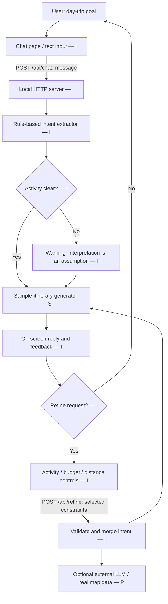

# System diagram — A2

Legend: **[I] implemented**, **[S] simulated**, **[P] planned**. The UI and HTTP handler are real; the response *content* is simulated. No LLM is connected.

**Data and control flows:** The browser sends JSON messages to `/api/chat`. The server parses text via regular expressions, returns intent metadata, an ambiguity flag and a deterministic illustrative answer. The browser shows a correction affordance. When selected, the browser sends structured options to `/api/refine`; the server validates them and regenerates the sample answer. All requests are local and stateless. The optional LLM / external data are not called.
